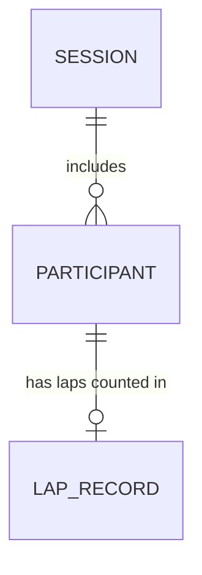

# Entity Model

The Lap Counter has no database. All data lives in the browser's local storage
under three keys (session settings, participant list, lap records). The model
below is the logical structure of that stored data; keys and references are
implied by how the code reads it, not enforced by a schema.

## Entity Relationship Diagram

### SESSION

The single counting session kept in a browser, with its lap length, clock state and editor state.

| Attribute       | Description                                                                 | Data Type | Length/Precision | Validation Rules                         |
|-----------------|-----------------------------------------------------------------------------|-----------|------------------|------------------------------------------|
| id              | Implicit identifier; a browser holds exactly one session                    | Long      | 19               | Primary Key                              |
| lap_length      | Length of one lap in metres                                                 | Integer   | 3                | Not Null, Values: 16, 25, 33, 50, 100, 200 |
| editor_open     | Whether the participant editor is currently open                            | Boolean   | -                | Not Null                                 |
| clock_started_at| Moment the session clock was first started; empty until the clock is started| DateTime  | -                | Optional                                 |
| clock_stopped_at| Moment the session clock was last stopped                                   | DateTime  | -                | Optional                                 |
| clock_state     | Whether the clock is running or stopped; empty until the clock is started   | String    | 4                | Optional, Values: RUN, STOP              |

### PARTICIPANT

A person whose laps are counted in the session, identified by name.

| Attribute  | Description                                         | Data Type | Length/Precision | Validation Rules                      |
|------------|-----------------------------------------------------|-----------|------------------|---------------------------------------|
| name       | Name of the participant as entered by the Timekeeper| String    | -                | Primary Key                           |
| session_id | Session the participant belongs to (implicit)       | Long      | 19               | Not Null, Foreign Key (SESSION.id)    |

#### Constraints

- The list is kept sorted by `name`.
- Uniqueness of `name` is assumed by the lap records but not enforced: a name entered twice appears twice and both entries share one lap record.

### LAP_RECORD

The running lap tally of one participant name. A record outlives its participant: removing a name from the list keeps its record, and re-adding the name brings the tally back.

| Attribute        | Description                                                                 | Data Type | Length/Precision | Validation Rules                          |
|------------------|-----------------------------------------------------------------------------|-----------|------------------|-------------------------------------------|
| participant_name | Name of the participant the tally belongs to                                | String    | -                | Primary Key, Foreign Key (PARTICIPANT.name) |
| lap_count        | Number of laps counted; may become negative through repeated corrections    | Integer   | 10               | Not Null                                  |
| last_change_at   | Elapsed session time in milliseconds when the count last changed            | Long      | 19               | Not Null, Min: 0                          |

#### Constraints

- The reference to `PARTICIPANT.name` is not enforced; records for removed participants stay until a reset (UC-005).
